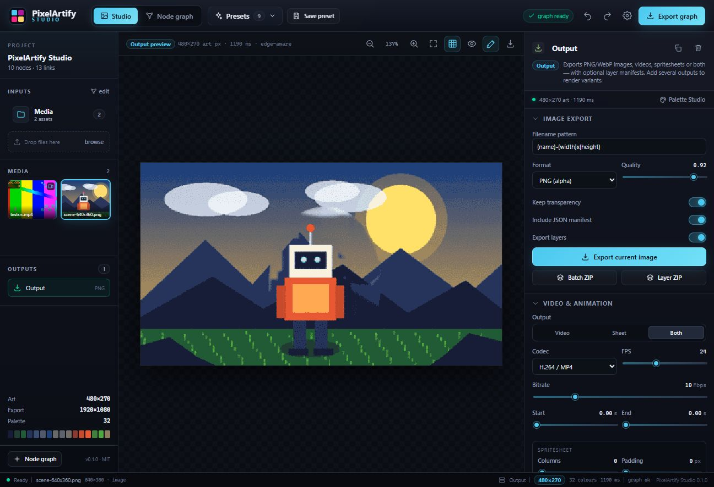
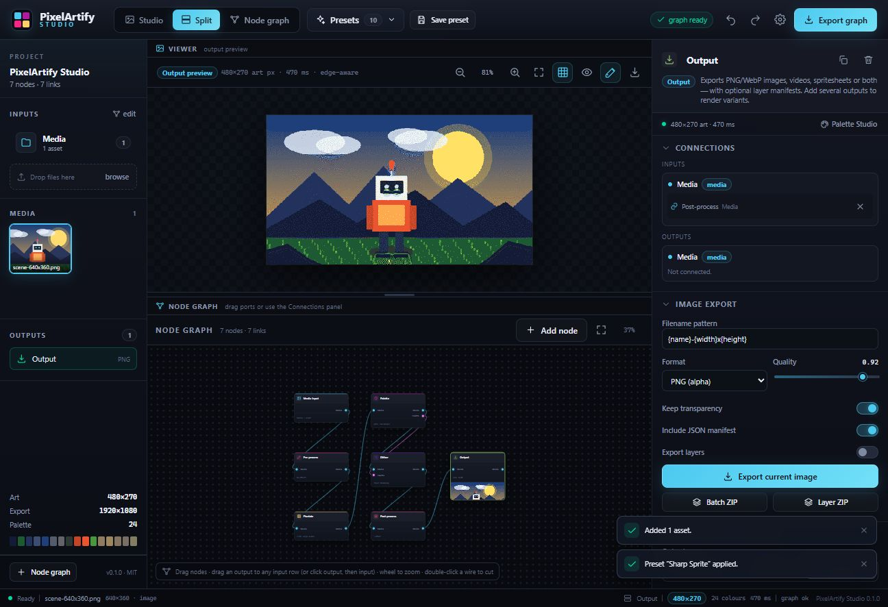
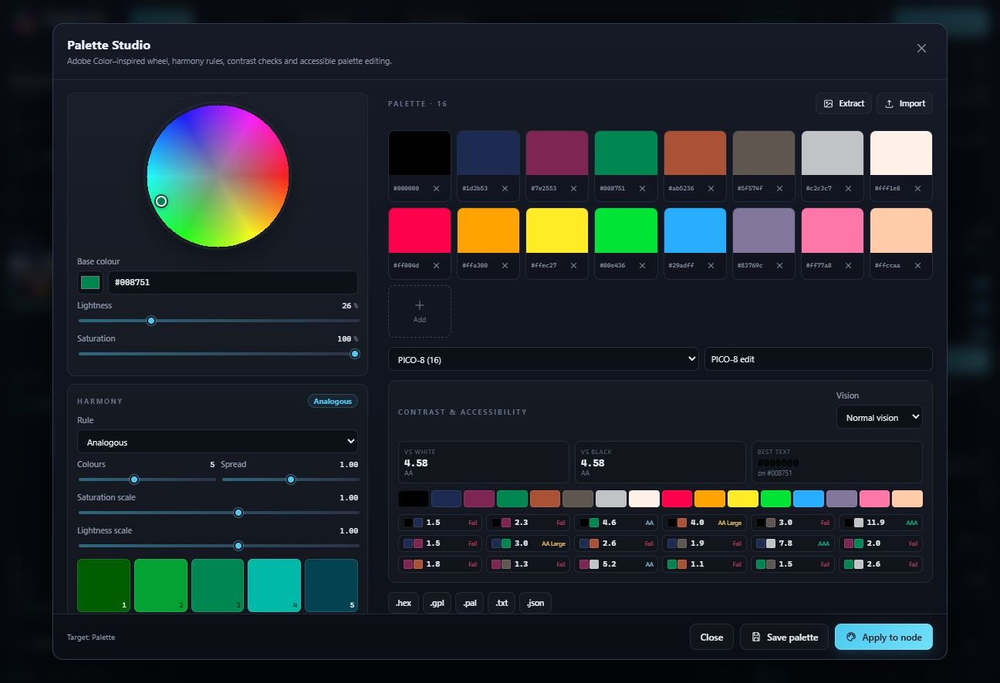
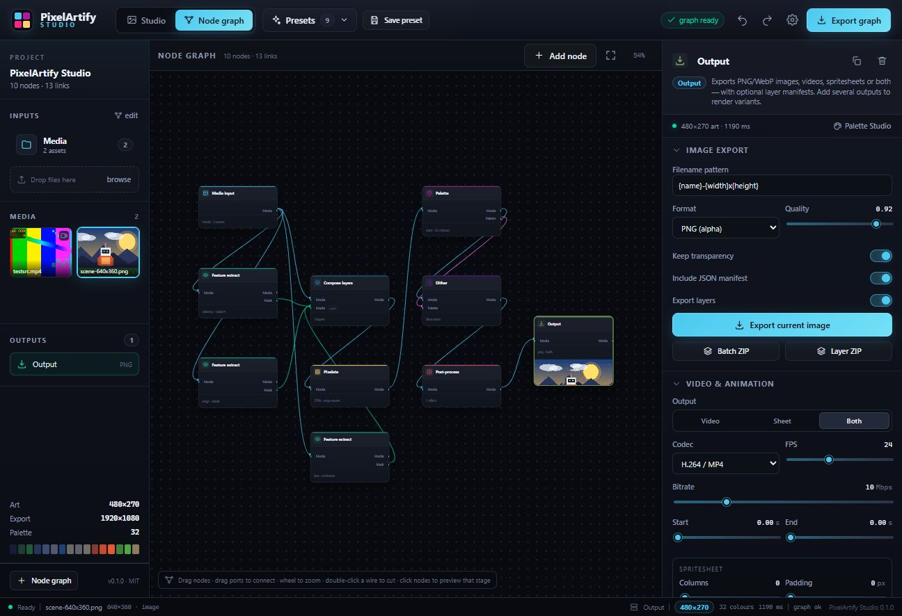

# PixelArtify Studio

[](https://github.com/GustafMos/pixelartify-studio/actions/workflows/ci.yml)
[](https://github.com/GustafMos/pixelartify-studio/actions/workflows/deploy.yml)
[](LICENSE)

**Edge-aware, resolution-independent pixel art at scale — with a node graph, palettes, dithering, layer separation, video and spritesheets.**

**Live demo:** <https://gustafmos.github.io/pixelartify-studio/>

PixelArtify Studio turns drawings, photos and videos into deliberate pixel art. It is built around the idea that pixel art is a *design resolution*, not a resized photo: a 480p and a 1080p source with the same preset produce the same art dimensions, the same feature scale and the same dither texture.



> MIT licensed · local-first · no account · no upload · images and video stay on your machine.

---

## Highlights

- **Visual node graph** — multiple media inputs (folders or multi-selections), branching chains, merged batches and multiple output nodes.
- **Split workspace** — a Blender-style viewer + node graph layout with a draggable divider, plus full Studio and Graph tabs.
- **Edge-aware sampling** — the sampler searches for cell windows that avoid cutting through edges, then blends an area average with the dominant local colour. Inspired by [pixel-mosaic](https://github.com/yogthos/pixel-mosaic).
- **Resolution independence by construction** — all radii, dither matrices and effect sizes are measured in art pixels. The engine supersamples to a canonical working resolution derived from the art size, never from the source.
- **Palette Studio** — extraction (median cut + OKLab k-means), Adobe Color–style harmony wheel, shades/tints, WCAG contrast checks and colour-blindness simulation. Import/export GPL, JASC-PAL, Paint.NET/Lospec `.hex`, plain hex and JSON.
- **28 dithering algorithms** — Bayer 2/4/8/16, blue noise (void-and-cluster), clustered dot, line, checker, dot, crosshatch, white noise, Floyd–Steinberg, Atkinson, Jarvis, Stucki, Burkes, Sierra, Two-row Sierra, Sierra Lite, Shiau–Fan, Simple 2D, Riemersma, and a Yliluoma-style palette blend.
- **10 pre-processing effects** — Kuwahara painterly, oil paint, watercolour, posterize, fractal noise displacement, grain, soften, sharpen, bloom and chunky blur.
- **8 post-processing effects** — sprite outline, bloom, grain, scanlines, vignette, chromatic aberration, CRT and final sharpen.
- **Crop, resize and channels** — nearest/bilinear/box/bicubic/Lanczos3 resampling, alpha-safe; channel extract/swap/pack, luma↔alpha and HSL→RGB channel encoding.
- **Layer extraction and inpainting** — saliency, subject box/ellipse, chroma key, luma, edge and manual masks. Background layers inpaint occluded regions with directional/mirrored fill, diffusion or dithered regeneration. Separate occlusion masks keep foregrounds tight while removing legs and shadows from the background.
- **Video in, video / spritesheet out** — frame-accurate WebCodecs decoding via [Mediabunny](https://mediabunny.dev), H.264/VP9/AV1 encoding, spritesheet packing with metadata, or both in one ZIP.
- **Presets** — save/import/export the whole graph. Built-ins include Sharp Sprite, Painterly Mosaic, 1-bit Ink, Game Boy DMG, Cinematic 32, Layered Parallax, Spritesheet Export, Chunky Sweetie and Batch Portraits.
- **Batch CLI** — folders of images, graph evaluation, video processing with ffmpeg, layer manifests and spritesheets.

---

## Screenshots

| Split workspace | Palette Studio |
| --- | --- |
|  |  |

| Full node graph |
| --- |
|  |

---

## Quick start

```bash
git clone https://github.com/GustafMos/pixelartify-studio.git pixelartify-studio
cd pixelartify-studio
npm install
npm run dev
```

Open <http://localhost:5173>. Everything runs locally. Drop images or videos onto the Media input node and connect the chain to an Output node.

```bash
npm run build      # typecheck + production build
npm run test       # 29 core tests
npm run cli -- --help
npm run build:cli  # bundle the headless CLI
```

### Browser support

The studio targets modern Chromium/Firefox/Safari. Video decoding/encoding uses **WebCodecs**, which is required for in-browser video. For older browsers or production video batches, use the CLI with ffmpeg.

---

## The graph

| Node | What it does |
| --- | --- |
| **Media input** | Folder / multi-selection of images and videos. Each asset flows through the graph independently. |
| **Crop** | Normalized, percent or pixel crop. Alpha and masks are cropped with it. |
| **Resize** | Nearest, bilinear, box, bicubic or Lanczos3. Retains premultiplied alpha. |
| **Channels** | Colour → channels: extract, swap, pack, luma→alpha, alpha→luma, HSL→RGB. |
| **Pre-process** | Ordered effect stack applied at the canonical working resolution. |
| **Pixelate** | Resolution policy + edge-aware sampler. Defines the art size. |
| **Palette** | Auto-extracted or custom palette; outputs media and palette sockets. |
| **Dither** | Algorithm, strength, pattern scale, colour space, serpentine scan, threshold and seed. |
| **Feature extract** | Saliency, subject box/ellipse, chroma, luma, edge or manual mask. Outputs a mask bundle. |
| **Compose layers** | Layer stack with visibility, opacity, blend, offsets, scaling, detail high-pass, masks, occlusion masks and inpainting settings. |
| **Post-process** | Outline, bloom, grain, scanlines, vignette, chromatic aberration, CRT, sharpen. |
| **Merge** | Concatenate multiple media bundles into one batch. |
| **Router** | Pure pass-through reroute for media, masks and palettes. Keeps branches intact when replacing or deleting a node. |
| **Output** | PNG/WebP, layer ZIP, batch ZIP, video, spritesheet or both. Multiple outputs render independent variants. |

**Connecting:** drag from an output dot to anywhere on an input port row, or click an output then click an input. The **Connections** panel in the inspector is a keyboard-friendly fallback for adding and removing connections. Drag from an input to an output too — both directions work.

**Disconnecting:** hover a wire and click the red × cut button, use the Connections panel, or double-click the wire. Deleting a node automatically bridges its upstream and downstream connections; if the node has several upstream branches, a **Router** node is inserted so the tree stays intact.

The **Split** tab shows the viewer and the node graph at the same time with a draggable divider. Mouse wheel zooms the graph; drag the background to pan. `G` cycles Studio → Split → Node graph.

**Only nodes that are actually in the branch affect the image.** A graph with just a Media input wired to an Output is a lossless pass-through. Add Pixelate, Palette, Dither or effect nodes when you want them; the default look is never applied implicitly.

The viewer's **Fit preview** button (active by default) keeps the image fitted with a small padding whenever you resize the split divider, switch tabs or resize the window. Zooming or panning turns auto-fit off; click the fit button to re-enable it.

### Resolution independence

All look-defining values are expressed in **art pixels** or normalized units:

- the art height/width/short-side/block size of the Pixelate node;
- pre/post effect radii and amplitudes;
- dither matrix scale;
- layer offsets and mask feather.

The pipeline resamples any source to a canonical supersampled working resolution derived from the **art size**, then samples down to the art grid. A 480p and a 1080p source therefore share the same grid and texture scale:

```text
854×480   ─┐
           ├─ fixed height 270 → 480×270 art, export 1920×1080 at 4×
1920×1080 ─┘
```

Use **Fixed height** or **Fixed width** for mixed-resolution batches. **Block size** intentionally derives the art size from the source, for chunky pixel-per-block workflows.

### Presets

A preset stores the entire node graph (including crop/resize/channel nodes), palette settings, dithering, layer configuration and output/video settings. Presets are JSON and self-contained; palettes are embedded.

```bash
# apply a built-in preset in the CLI
npm run cli -- input-folder -o out --preset layered-parallax --height 270 --layers
```

Save/load presets from the top bar. Import/export `.pixelartify.json` files. User presets and palettes persist in `localStorage`.

---

## Palettes

- Extract from the active image with median cut + OKLab k-means.
- Build palettes with harmony rules: monochromatic, analogous, complementary, split-complementary, triadic, tetradic, square, compound.
- Inspect WCAG contrast grades and simulate protanopia, deuteranopia, tritanopia and achromatopsia.
- Built-ins: PICO-8, Game Boy DMG, Sweetie 16, Endesga 32, DawnBringer 16, CGA 16, Grayscale 16, 1-bit Ink.
- Formats: GIMP `.gpl`, JASC `.pal`, Paint.NET/Lospec `.hex`/`.txt`, plain hex, JSON.

Color matching happens in OKLab by default (perceptual), with sRGB and linear-RGB options for dithering.

---

## Dithering

The catalog is inspired by **Ditherista / libdither** by Robert Kist (MIT/BSD) and the classic literature. The implementations in this repository are original TypeScript, not a port of the C/C++ code.

- **Ordered**: Bayer 2×2, 4×4, 8×8, 16×16; void-and-cluster blue noise; clustered dot 4×4/8×8.
- **Pattern**: horizontal/vertical/diagonal lines, checkerboard, dot screen, crosshatch, white noise, hard threshold.
- **Error diffusion**: Floyd–Steinberg, Atkinson, Jarvis–Judice–Ninke, Stucki, Burkes, Sierra, Two-row Sierra, Sierra Lite, Shiau–Fan, Simple 2D, Riemersma (Hilbert curve).
- **Palette blend**: Yliluoma-style ordered two-colour projection.

Every algorithm honours `strength`, `scale` (art pixels), `threshold` bias and seed. Diffusion can be serpentine; matching can be OKLab, linear or sRGB.

---

## Layers, masks and inpainting

1. Add an **Extract** node and choose a method:
   - **Saliency** — central, compact, high-contrast subject detection with component analysis and leg extension.
   - **Subject box/ellipse** — predictable cutout region for characters.
   - **Chroma / luma / edge** — keying, tonal masks, detail masks.
   - **Manual** — paint directly on the preview with add/erase, softness, invert and feather.
2. Add a **Compose layers** node and connect one or more mask bundles.
3. Layer roles:
   - **Background** — full image, optionally inpaints regions hidden by higher layers.
   - **Foreground** — cut out by its mask.
   - **Detail** — edge high-pass overlay.
   - **Overlay** — full image or masked texture.
4. For a character, use a tight **subject** mask for the foreground and a looser **occlusion mask** (box/ellipse or low-threshold saliency) only for background removal. The SOC (subject/occlusion) split keeps the cutout tight while ensuring legs, shadows and antialiased edges are removed from the background.
5. Inpaint methods:
   - **Directional / mirrored fill** — clones a coherent background patch and blends directional samples (default).
   - **Pyramid + diffusion** — multi-scale fill + Jacobi relaxation.
   - **Pyramid fill only**.
   - **Dithered regeneration** — adds palette-aware texture to the regenerated area.

Layer offsets and scales are in art pixels, ready for parallax rigs.

---

## Video and spritesheets

Import a video into a Media input. The Studio shows a scrubbable frame preview. The Output node can produce:

- **Video** — MP4 (H.264 or AV1) or WebM (VP9), using WebCodecs + Mediabunny, with the original audio muxed in the CLI.
- **Spritesheet** — PNG sheet + JSON metadata (frames, source size, duration, columns, rows, cell size). Explicit column counts are honoured; auto mode picks the most square layout that fits the max size.
- **Both** — downloaded together as a ZIP.

For production video, the CLI uses the bundled ffmpeg for frame extraction and final encoding, preserving the original audio.

> Browser video export is silent by design: audio is not re-muxed client-side. Use the CLI when audio matters. H.264/VP9 output flattens alpha to a solid background; use PNG spritesheets for transparency.

---

## CLI

The CLI runs the same core engine, including graph evaluation, masks, layers and geometry nodes.

```bash
# Build once
npm run build:cli

# Images
node dist-cli/pixelartify.mjs ./art -o ./out \
  --preset sharp-sprite --height 270 --scale 4 --layers

# Custom palette + blue noise
node dist-cli/pixelartify.mjs hero.png -o out \
  --palette-file sweetie16.hex --dither blue-noise --dither-scale 1

# Mixed-resolution batch
node dist-cli/pixelartify.mjs ./mixed -o out --height 270 --format png

# Video → MP4 + spritesheet
node dist-cli/pixelartify.mjs clip.mp4 -o out \
  --height 270 --fps 12 --video-output both \
  --codec avc --crf 18 --sheet-columns 8

# Introspection
node dist-cli/pixelartify.mjs --list-presets
node dist-cli/pixelartify.mjs --list-dithers
```

Run `npm run cli -- --help` during development. Requires Node 20+; image I/O uses `sharp`; video uses the bundled `@ffmpeg-installer/ffmpeg`.

---

## Architecture

```text
src/
  core/                 pure TypeScript engine (browser, worker, Node)
    color.ts            sRGB/linear, OKLab, HSL, WCAG, harmony, CVD
    image.ts            resampling (nearest/bilinear/box/bicubic/Lanczos3),
                        compositing, masks, blur/sharpen, integral images
    preprocess.ts       10 pre effects + 8 post effects + registry
    edges.ts            Sobel + NMS + percentile threshold
    pixelate.ts         edge-aware sampling + offset field
    inpaint.ts          pyramid, directional/mirrored clone, diffusion, dither
    extraction.ts       saliency / box / chroma / luma / edge masks
    palette.ts          extraction, matching, formats, built-ins
    dither.ts           28 algorithms + registry
    channels.ts         channel routing and alpha retention
    pipeline.ts         resolution policy → pre → layers → pixelate → palette →
                        dither → post → export scale
    graph.ts            typed DAG, multi-port evaluation, caching
    spritesheet.ts      packing + texture metadata
    presets.ts          built-ins, graph ↔ settings, validation/migration
  app/                  React + Vite studio UI
    components/         graph editor, viewer, inspector, palette studio, masks
    store.tsx           graph/assets/presets/masks/preview state
    video.ts            Mediabunny probe / decode / encode
  cli/                  headless batch + video
```

The core is DOM-free. The browser UI, the CLI and future workers all call the same functions.

### Adding an effect or dither

- Add a definition and implementation in `src/core/preprocess.ts` (`PREPROCESS_DEFS` or `POSTPROCESS_DEFS`), and a case in the apply switch. The inspector UI is generated from the parameter metadata.
- Add a kernel/matrix in `src/core/dither.ts` and a registry entry. `applyDither` handles ordered, diffusion and special dispatch.

### Adding a node type

1. Extend `GraphNodeType` in `types.ts`.
2. Add a `NODE_DEFS` entry and `nodeParams` case in `graph.ts`.
3. Implement its evaluation case (return typed port values).
4. Add an inspector panel and an icon mapping.
5. Add a test.

---

## Tests

```bash
npm run test
```

Covered: resolution independence, resampling/alpha correctness, palette formats and extraction, dither palette exactness and determinism, render pipeline, layer inpainting, crop/resize/channel graph nodes, cycle detection, preset round-trip and upscaling.

---

## Known limitations

- **Automatic subject extraction is heuristic**, not ML. Saliency works best on centered, high-contrast subjects with simple backgrounds. Use the subject box or paint masks for production sprites. Chroma/luma/edge modes cover predictable cases.
- Inpainting is a fast classical fill, not a generative model. Large holes can show duplicated structure. Directional fill + texture is a starting point; mask painting gives the best control.
- Browser video export does not mux audio and flattens alpha for H.264/VP9.
- Very large art sizes (>1024) or heavy layer stacks can make interactive previews slow. Use the wand icon in the viewer to toggle full-quality preview; exports always use full quality.
- The CLI evaluates image graphs; video uses the preset's render settings (frame-by-frame graph geometry is intentionally not applied).

---

## Credits

PixelArtify Studio stands on the shoulders of open-source work. See [CREDITS.md](CREDITS.md) and [THIRD_PARTY_NOTICES.md](THIRD_PARTY_NOTICES.md) for full links and licenses.

Special thanks to:

- **Yogthos** — [pixel-mosaic](https://github.com/yogthos/pixel-mosaic) (MIT), the edge-aware pixelation inspiration.
- **Robert Kist** — [Ditherista](https://github.com/robertkist/ditherista) and [libdither](https://github.com/robertkist/libdither), the dithering catalog inspiration.
- **Vanilagy** — [Mediabunny](https://mediabunny.dev) (MPL-2.0), browser media I/O.
- **Björn Ottosson** — [OKLab](https://bottosson.github.io/posts/oklab/) (MIT).
- The pixel-art community behind the PICO-8, Sweetie 16, Endesga 32, DawnBringer 16 and Game Boy palettes.

This project is not affiliated with Adobe. Adobe Color inspired the harmony/contrast panel.

---

## License

MIT. See [LICENSE](LICENSE). Third-party dependencies retain their licenses; Mediabunny is MPL-2.0 and is used unmodified as a dependency.

